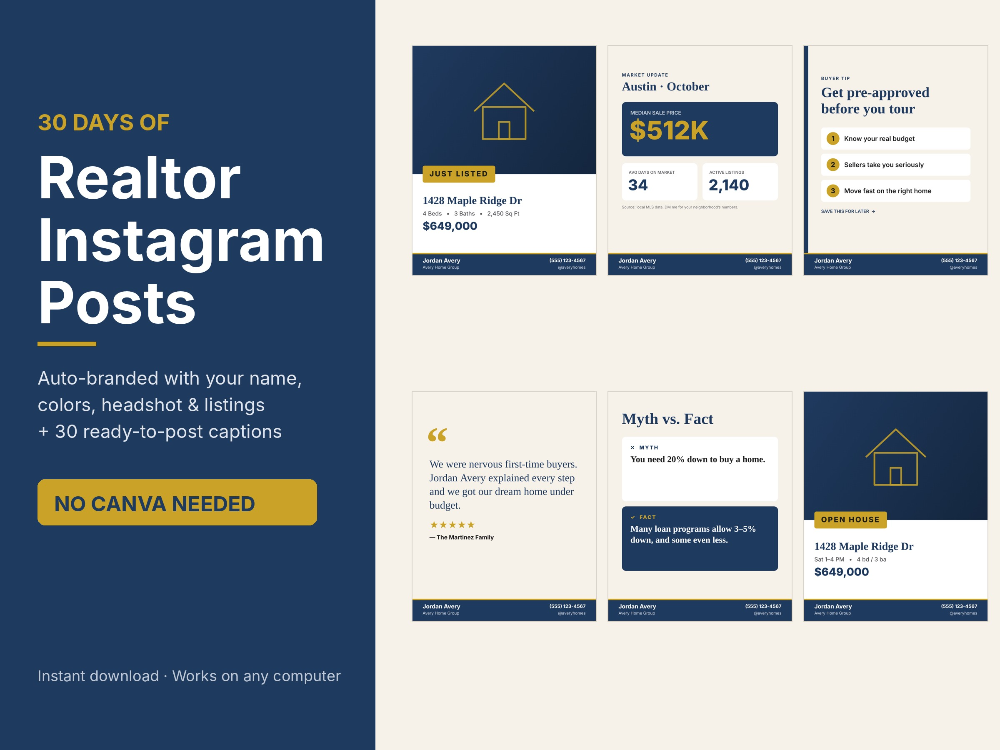
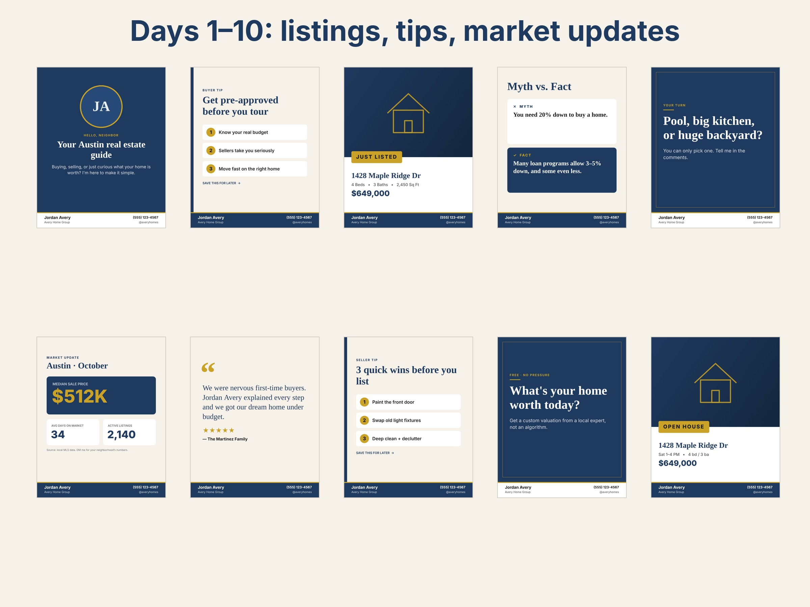

# Realtor Post Studio: everything we built + the plan

*Paste or upload this document into any Claude chat to pick up where we left off.*

## The short version
- **Product:** Realtor Post Studio, a **$19** digital download for real estate agents.
- **What it does:** it's a single file the agent opens in any web browser. They type in their name, brokerage, phone and city, choose brand colors, and add a headshot and a listing photo. One click gives them **30 branded social media posts plus 30 ready-to-post captions with hashtags**. No Canva, no designer, no internet needed.
- **Sizes:** Instagram/Facebook feed (1080×1350), square (1080×1080), Story/Reel/TikTok cover (1080×1920).
- **Post types:** Just Listed, Open House, Under Contract, Just Sold, Price Improved, Coming Soon, Market Update, Buyer Tips, Seller Tips, Myth vs Fact, Testimonials, Meet the Agent, and engagement questions.
- **Extras:** 6 color themes or fully custom colors, "download all 30" in one click, and the agent's settings are saved so they can reuse it for every new listing.
- **Pricing:** $19 kit · $47 done-for-you (we enter their details and send the PNGs, about 10 minutes of work) · later a $9/month subscription for 30 new posts each month.
- **Why it can win:** realtor templates are proven sellers on Etsy, but nearly all of them are Canva templates that look alike. Ours brands itself, so we can DM an agent a **free sample post with their own name on it**. Template shops can't do that.
- **Marketer:** the owner's wife is the face of the brand: short videos plus personal DMs to agents.
- **Budget:** about $0–40/month.

## Files we created (GitHub repo `jmillsrpv-lgtm/gdp-dashboard`, branch `claude/realtor-social-kit`)

| File | What it is |
|---|---|
| `realtor-kit/product/realtor-post-studio.zip` | **The file customers buy** (the studio + a Start Here guide) |
| `realtor-kit/product/realtor-post-studio.html` | The studio itself |
| `realtor-kit/product/START-HERE.txt` | Instructions for buyers |
| `realtor-kit/marketing/listing-images/` | 4 store images (cover, two post previews, "What's included") |
| `realtor-kit/marketing/samples/` | All 30 sample posts as PNGs |
| `realtor-kit/marketing/LISTINGS-AND-SCRIPTS.md` | Etsy and Payhip copy, 10 video scripts, DM script |
| `realtor-kit/marketing/MARKETER-PLAYBOOK.md` | The wife's daily routine, rules and tracker |
| `realtor-kit/PLAN.md` | Launch plan and budget |
| `realtor-kit/tools/` | Scripts that regenerate the images if the designs change |

## Status and next steps
- Done: product, listing images, store copy, video scripts, launch plan, marketer playbook.
- **Not done yet. A person has to do these:** create the Payhip and Etsy accounts (they need ID and bank details), publish the listings, set up social accounts, and send DMs.
- Ideas for later: a holiday post pack for Q4, swapping in our own brand name and colors, and a $9/month web-app version once there are about 20 sales.

## What the product looks like

# Part 1: Realtor Post Studio: launch plan (under $40/month)

## What we're selling and why
**Product:** a one-file tool that turns an agent's name, colors, headshot and listing into 30 branded Instagram/Facebook/TikTok posts plus 30 captions. Price: **$19**. Upsell: **$47 done-for-you**.

**Why this product:**
- Real estate agents are a large group of buyers who already spend money on marketing and are told to post daily.
- Realtor social templates are proven sellers on Etsy. The catch is that the category is crowded with near-identical Canva template shops.
- **Our edge:** no Canva. It brands itself automatically, so you can show a *personalized free sample* in a DM, which template shops can't do. That one move is our main sales channel.
- It costs nothing to deliver, so every sale is close to 100% margin minus platform fees.

**Honest expectations:** nothing digital is a sure thing. A brand-new Etsy shop with no reviews usually gets few organic views for the first few weeks. Early sales will come from **direct outreach and short videos**, not from Etsy search. A realistic target is the first sale within 1–2 weeks of daily outreach and 20–50 sales in month one. That depends entirely on doing the daily outreach.

## Monthly budget

| Item | Cost | Needed? |
|---|---|---|
| Etsy listing fee | $0.20 per listing, then 6.5% + ~3% + $0.25 per sale | Yes |
| Payhip (free plan) or Gumroad as your own checkout | $0 upfront, 5% (Payhip) or 10% + $0.50 (Gumroad) per sale | Yes, pick one |
| TikTok, Instagram, Facebook, Pinterest | $0 | Yes |
| Free scheduler (Metricool free plan or Meta Business Suite) | $0 | Yes |
| Domain (.com ≈ $12/yr; .io ≈ $40–60/yr) | $1–5/mo | Later |
| Etsy Ads, only after 3+ reviews | $1–3/day, capped | Optional |
| **Total** | **≈ $0–40/mo** | |

Skip these for now: Stan Store ($29/mo), Canva Pro, paid schedulers, any course or "AI agent" subscription.

## 14-day launch

**Day 1 (about 1 hour, you do this):**
1. Create a Payhip (or Gumroad) account. Upload `product/realtor-post-studio.zip` and listing images 01–04 from `marketing/listing-images/`. Paste the copy from `marketing/LISTINGS-AND-SCRIPTS.md`. You get a live $19 link.
2. Open an Etsy shop and create the same listing. Etsy needs ID and bank verification, so start today because approval can take a day or two.
3. Put the Payhip link in your TikTok, Instagram and Facebook bios.

**Days 2–14 (about 45–60 min/day):**
- **20 personalized DMs per day** to agents who posted a listing this week. Search Instagram for `#justlisted + your city` and other cities. Use the DM script, and send each agent their Day 1 post with their own name on it. This is the money channel.
- **1–2 short videos per day** from the 10 scripts (screen-record the studio). Post the same video to TikTok, Reels, Shorts and Pinterest Idea Pins.
- **Join 5 realtor Facebook groups.** Help people first. Where the rules allow, share a free sample post ("comment your city and I'll make you one").
- After each sale, ask for a review. Etsy ranking depends on reviews.

**After 10 sales:** add the $47 done-for-you option and a holiday pack (Thanksgiving / Christmas / New Year posts). Seasonal packs sell well in Q4.

## Phase 2: web app with a paywall (after about 20 sales)
The studio is already the core of a web app. Once buyers prove demand:
- Host it as a subscription site (Floot or Lovable; both are connected to this workspace), with Stripe at **$9/month for 30 fresh posts every month**. Recurring revenue beats one-time $19 sales.
- Buy the domain then, not before. A .com is cheaper and more trusted than .io for realtor buyers.
- Build this only after paying customers ask for "more posts next month." That's the signal.

## What's automated vs. what you do
- **Automated, already built:** the product, post rendering, captions, listing images, and marketing copy. `tools/render-samples.js` and `tools/make-listing-images.py` rebuild every image if we change a design.
- **You do (platforms require a real person):** account sign-ups and ID/bank verification, publishing the listings, and sending DMs. Auto-DM bots get accounts banned, so DMs stay manual.
- **I can do next, with your go-ahead:** schedule the 10 videos' captions through Metricool, set up the Payhip/Stripe products, build a holiday pack, or start the Phase 2 web app.

# Part 2: Marketer Playbook: the face of Realtor Post Studio

You're the face and the voice of the brand. Realtor social media is a relationship business: agents buy from someone they like and trust on camera. Your job is to be the helpful "social media friend for realtors." It takes about 60–75 minutes a day.

## Who you're selling to
Real estate agents, mostly newer and solo agents, who know they should post every day but don't have the time or design skills. The biggest groups are women aged 28–55 and teams that want a consistent look.

**Your one-line pitch:** "I'll give you a month of branded posts with your name on them in 5 minutes. No Canva."

## Setup (first weekend, about 2 hours)
1. **Handle:** pick one name and use it everywhere: TikTok, Instagram, Facebook page, Pinterest. Something like `@postsforrealtors`, `@realtorpoststudio` or `@[yourname]forrealtors`.
2. **Bio:** "Done-for-you Instagram posts for realtors 🏡 30 days in 5 min · No Canva ↓" plus the Payhip link.
3. **Profile photo:** a friendly, well-lit photo of your face. Faces beat logos for trust.
4. Make **3 sample posts with your own name** in the studio and pin them to your Instagram grid.
5. Join 5–10 realtor Facebook groups (search "real estate agents [your state]", "new real estate agents", "realtor marketing"). Read each group's promo rules.

## Daily routine (Mon–Fri)

| Time | Task | Goal |
|---|---|---|
| 20 min | **1 short video** (TikTok, then repost the same file to Reels, Shorts and Pinterest) | Get seen |
| 30 min | **20 DMs** to agents who posted a listing this week (`#justlisted` + city). Offer a free sample post with their name on it | **Sales** |
| 10 min | Make and send the samples people said yes to, then send the $19 link | Close |
| 10 min | Comment helpfully on 10 realtor posts or group threads | Get noticed |
| 5 min | Log everything in the tracker below | Know what works |

**Weekends:** batch-film 5 videos for the week. Do one "comment your city and I'll make your post" video and reply to the comments with video responses.

## Videos where you're the face (talk to the camera, 7–20 seconds)
1. "Realtors, I'm going to save you $300 a month." → screen-record typing a name → all 30 posts change.
2. "If you're a new agent with an empty Instagram, watch this." → scroll the grid.
3. "Comment your city and I'll make your market update post for free." → reply-video for each commenter. **This is your best one for reach.**
4. "Rating realtor Instagram posts 1–10." → react to generic posts, then show yours. Be nice, never mean.
5. "Which color theme are you: 1, 2, 3, 4, 5 or 6?" → this drives comments.
6. "Day in my life running a little business for realtors." → behind the scenes builds trust.
7. "Broker gift idea your agents will actually use." → aimed at team leads, which leads to bulk sales.
8. "Things new agents waste money on (and what to do instead)." → helpful first, product last.

**Every video:** hook in the first 2 seconds, captions on screen, end with "link in my bio."

## DM script (send by hand, never with a bot)
> Hi {name}! Saw your listing on {street}, gorgeous! 😍 I make done-for-you Instagram posts for realtors. Can I send you a free Just Listed post with your branding on it? No strings.

If they say yes: make it in the studio, send the PNG, then:
> Here you go! If you like it, the full kit is 30 days of posts like this + captions for $19: {link}. Happy to set it up for you for $47 if you'd rather not touch it.

If they don't reply, follow up once 3 days later. Then let it go.

## Rules that keep us safe
- **Always be upfront that it's your product.** Say "I made this" or "my shop." Never post as if you're an unrelated happy customer. The FTC treats fake testimonials and undisclosed self-promotion as deceptive.
- Only use real reviews from real buyers. Screenshots need their permission.
- Follow each Facebook group's promo rules, or you'll get removed.
- Keep it to 20–30 DMs a day per account. More than that looks like spam and gets accounts restricted.

## Tracker (copy into a Google Sheet)
| Date | Videos posted | Best video views | DMs sent | Replies | Samples sent | Sales $19 | Sales $47 | Revenue |
|---|---|---|---|---|---|---|---|---|

**Check every Sunday:** double down on whichever video type or DM opener got the most replies.

## The numbers we're aiming for
- 20 DMs/day × 5 days = 100 DMs a week
- About 15–25% reply, so about 15–25 free samples a week
- About 20–30% of those buy, so **about 4–7 sales a week from DMs alone** (≈ $75–150+), plus whatever the videos bring in
- These are targets, not promises. Track your real numbers and adjust after week 2.

# Part 3: Store listings + TikTok/Reels scripts (copy-paste ready)

## Etsy listing

**Title (140 chars max):**
Realtor Instagram Posts | 30 Day Real Estate Social Media Templates | Auto-Branded, No Canva | Just Listed Open House Captions Bundle

**Price:** $19 (shows as a sale: $38 → $19 at 50% off for the first 30 days)

**13 tags:**
realtor instagram, real estate posts, realtor templates, real estate social, just listed post, open house template, realtor marketing, real estate agent, realtor captions, realtor branding, realtor gift, real estate canva, broker social media

**Category:** Digital Prints → or "Templates → Social Media Templates" (pick whichever Etsy suggests)
**Who made it:** I did · **What is it:** A finished product · **Production partner:** none
**AI disclosure:** In the description, say the designs and captions were created with AI-assisted tools. Etsy expects this.

**Description:**
Stop staring at a blank Instagram feed. This is 30 days of polished, on-brand real estate posts, plus the captions, that brand themselves with YOUR name, colors, headshot and listings in about 5 minutes.

No Canva account. No design skills. Open the file, type your details, and click "Download all 30."

WHAT YOU GET
• 30 professionally designed posts: Just Listed, Open House, Under Contract, Just Sold, Price Improved, Coming Soon, Market Update, Buyer & Seller Tips, Myth vs Fact, Testimonials, Meet the Agent, and engagement posts
• 30 ready-to-post captions with hashtags for your city
• 3 sizes: Instagram/Facebook feed (1080×1350), square (1080×1080), Story/Reel/TikTok cover (1080×1920)
• 6 luxury color themes, or match your exact brand colors
• Reuse it forever. Swap in each new listing in seconds

HOW IT WORKS
1. Download and open the file in any web browser (Mac or PC)
2. Type your name, brokerage, phone and city, then upload your headshot
3. Download all 30 posts as PNGs and post one a day

Perfect for new agents, solo agents, teams, and as a closing gift from brokers and lenders.

Personal license: 1 agent or team. Instant digital download. No physical item ships.
Designs and captions were created with the help of AI-assisted tools and reviewed by hand.

## Gumroad / Payhip / Stan Store (your own checkout, lower fees)

**Name:** The 30-Day Realtor Post Studio
**Price:** $19 (main) · $47 "Done-For-You" (we brand it and send the files within 48h) · pay-what-you-want minimum $19 on Gumroad works well for tips
**Short pitch:** 30 days of branded Instagram posts + captions for real estate agents. Your name, colors and listings in about 5 minutes. No Canva.
Use the same description as Etsy. Upload `realtor-post-studio.zip` and listing images 01–04.

**Order bump / upsell ideas** (sell these after you get your first 10 sales):
- "Done-For-You" branding: $47. You enter their details and email them the 30 PNGs (about 10 min of work).
- Monthly refill: $9/mo for 30 new posts each month. Add it once there's demand.

## 10 short videos for TikTok / Reels / Shorts
Film each one as a screen recording of the studio, 7–20 seconds, with on-screen text and a trending sound. Post 1–2 per day.

1. **Hook:** "Realtors, stop paying $300/month for social media." → show typing your name → all 30 posts change → "$19. Link in bio."
2. **Hook:** "I made 30 days of Instagram posts in 4 minutes." → timer overlay → download all.
3. **Hook:** "POV: you just got a listing and need a Just Listed post NOW." → upload photo → post appears.
4. **Hook:** "Which theme fits your brand? 1–6" → click through the 6 themes. (This drives comments.)
5. **Hook:** "New agent? Here's your first month of content, done." → scroll the grid.
6. **Hook:** "No Canva. No designer. No excuses." → fast cuts of posts.
7. **Hook:** "Things realtors post vs. what actually gets clients." → Myth vs Fact posts.
8. **Hook:** "Broker gift idea your agents will actually use." → aim this at team leads.
9. **Hook:** "Your listing photos deserve better than a phone screenshot." → before/after.
10. **Hook:** "Comment your city and I'll make your market update post." → do it in a reply video. This is the best one for engagement.

**Pinned comment on every video:** "Link in bio: 30 posts + captions, $19. Works on any computer."

## Direct outreach DM (Instagram/Facebook). Send 20 per day, by hand.
> Hey {first name}! Loved your recent listing on {street}. I made a tool that turns your name + brand colors into 30 days of ready-to-post Instagram content in about 5 minutes (no Canva). Want me to send you a free sample post with your branding on it?

When they reply yes: make their Day 1 post in the studio, send the PNG, then send the $19 link. Free personalized samples convert far better than links.
